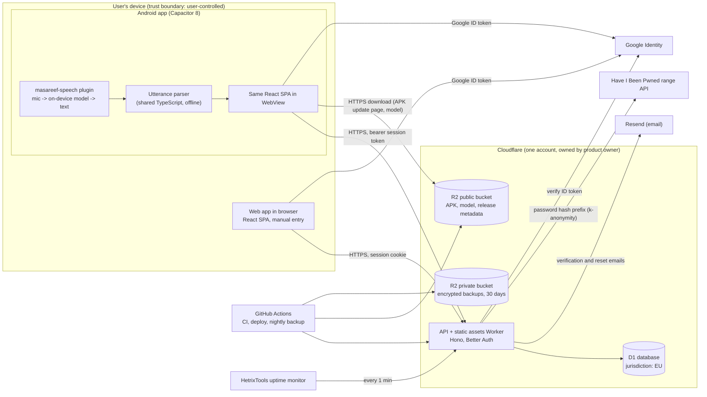

# Architecture: Masareef (مصاريف)

| | |
|---|---|
| Version | 0.1 |
| Date | 2026-11-16 |
| Status | Draft (awaiting sign-off). The voice recognition choice (ADR 0002) is PROVISIONAL until the proof of concept in the first build milestone has been measured |
| Source | docs/02-requirements.md v0.1 (signed off 2026-11-16); docs/01-vision.md; product owner's design answers of 2026-11-16 |

How to read this document:

- **[FACT]** marks something the product owner stated. **[VERIFIED]** marks something the planner checked on 2026-11-16 against the source named next to it. **[ASSUMED]** marks something the planner filled in; each is listed under "Risks and open points" or in an ADR.
- `<domain>` stands for the domain name the product owner has not yet bought (prerequisite P-02). `<applicationId>` stands for the Android application identifier, proposed as `com.masareef.app` and fixed for ever at the first signed release (open point D-04).
- "PoC" is the voice proof of concept. By the product owner's decision of 2026-11-16 it is the first build task, not a Design activity; this document picks the approach from documented evidence and the PoC can change it through a new ADR.

## Product owner's design answers (2026-11-16) [FACT]

| Question | Answer | Effect on this design |
|---|---|---|
| How should design handle the voice decision when no recordings or code exist yet? | "Decide on research, PoC first in build" | ADR 0002 is provisional; section "Voice proof of concept" gives the pass/fail criteria and what changes on failure |
| Who maintains Masareef and with what technology? | "Me, with Claude; no preference" | One maintainer with AI assistance: one language (TypeScript) across web, Android shell, API and tooling; one hosting provider; no servers to patch |
| Which accounts already exist? | "None yet" | Every account is new and owned by the product owner; listed under "Prerequisites" |
| Who supplies voice recordings and reviews Arabic text? | "Start with synthetic/public audio" | The PoC uses generated and public audio; real speakers are added before release; PoC accuracy numbers carry a stated margin. Arabic text review by a native speaker stays open before release |

## Overview

Masareef is one TypeScript single-page web application that runs in two shells: directly in the browser, and inside an Android app built with Capacitor (the same web code bundled into the APK and shown in the system WebView). On Android only, a small native plugin records audio and runs a bundled open speech model on the phone; the resulting text goes to a rule-based parser (shared TypeScript, no network) that fills the review screen. Both shells talk over HTTPS to one stateless API running on Cloudflare Workers, which stores data in one Cloudflare D1 (SQLite) database pinned to the EU jurisdiction. The same Worker serves the web app, the download page and the policy pages. The APK and the speech model are plain files in a public object-storage bucket. Audio and transcripts never leave the device; the only expense-related request is the one sent when the user presses Save.



What deliberately does not exist: a cloud speech service, an admin console, a message queue, a cache layer, containers, a separate analytics provider, a separate web host, WebSockets.

## Stack

Every version below was looked up on the date shown, not recalled. "Latest" means the registry's `latest` tag or the vendor's latest stable release on that date. Three items are deliberately held below latest; ADR 0010 gives the reasons and they need entries in `.software-house/deps-allow.json`.

| Layer | Choice | Version | Verified on | Source | Why |
|---|---|---|---|---|---|
| Language | TypeScript | 6.0.3 (latest is 7.0.2; held back, ADR 0010) | 2026-11-16 | `npm view typescript@"<6.1.0" version`; `npm view typescript dist-tags` | One language for web, Android shell, API, parser and tooling. Held at 6.0.x because typescript-eslint 8.72.2 declares `typescript >=4.8.4 <6.1.0` |
| Tooling runtime | Node.js LTS "Lithium" | 26.13.1 | 2026-11-16 | https://nodejs.org/dist/index.json | Current LTS; used for build, tests and CI only (the API does not run on Node). The development machine has 22.14.0 and must be upgraded; `.nvmrc` pins this |
| Package manager | npm (workspaces) | 12.2.2 | 2026-11-16 | `npm view npm version` | Ships with Node; no extra tool. Lockfile committed, CI uses `npm ci` |
| API runtime | Cloudflare Workers | compatibility date 2026-11-16 (the platform has no version number) | 2026-11-16 | https://developers.cloudflare.com/workers/platform/pricing/ ; /workers/platform/limits/ | No servers to patch, no idle pause, no cold-start seconds, USD 5 per month flat. ADR 0004 |
| Deploy tool | Wrangler | 4.163.0 | 2026-11-16 | `npm view wrangler version` | Official Cloudflare CLI: deploy, D1 migrations, export, rollback |
| API framework | Hono | 4.13.18 (published 2026-11-11) | 2026-11-16 | `npm view hono version` | Small, runs on Workers and on Node unchanged, which is the exit path (ADR 0004) |
| API contract | @hono/zod-openapi | 1.6.3 | 2026-11-16 | `npm view @hono/zod-openapi version` | One schema validates input at the boundary and generates the OpenAPI file kept in the repository |
| Validation | Zod | 4.6.7 | 2026-11-16 | `npm view zod version` | Shared by API and client forms; required `^4` by @hono/zod-openapi |
| Database | Cloudflare D1 (managed SQLite), jurisdiction `eu` | managed service | 2026-11-16 | https://developers.cloudflare.com/d1/configuration/data-location/ ; /d1/reference/time-travel/ ; /d1/reference/data-security/ | Included in the USD 5 plan, 30-day point-in-time restore, AES-256 at rest, plain SQLite file as exit path. ADR 0004, ADR 0009 |
| Database access and migrations | Drizzle ORM / drizzle-kit | 0.45.4 / 0.31.11 | 2026-11-16 | `npm view drizzle-orm version`; `npm view drizzle-kit version` | Typed, parameterised queries; SQL migration files; same code works on D1 and on a SQLite file. Versions satisfy Better Auth's peer range |
| Authentication | Better Auth | 1.7.25 (published 2026-11-14) | 2026-11-16 | `npm view better-auth version`; https://www.better-auth.com/docs | Maintained library: email and password with verification, Google ID-token sign-in, database sessions, account linking, account deletion. ADR 0005 |
| Password hashing | Argon2id from @noble/hashes | 2.4.0 (published 2026-08-27) | 2026-11-16 | `npm view @noble/hashes version`; OWASP Password Storage Cheat Sheet | Argon2id at OWASP's minimum (m=19456 KiB, t=2, p=1). Pure JavaScript, so it runs on Workers, which do not allow WebAssembly compiled at run time. ADR 0005 |
| Object storage | Cloudflare R2 | managed service | 2026-11-16 | https://developers.cloudflare.com/r2/pricing/ ; /r2/reference/data-location/ | Free 10 GB, no egress charge: hosts the APK, the speech model and the encrypted backups |
| Transactional email | Resend, HTTPS API called with `fetch` (no SDK) | API (no client library) | 2026-11-16 | https://resend.com/pricing | Free plan: 3,000 emails per month, 100 per day. Behind an `EmailSender` interface so it can be swapped |
| Web UI | React / react-dom | 19.3.1 | 2026-11-16 | `npm view react version` | Most widely used; best supported by AI assistance and by the accessibility library below |
| Build | Vite / @vitejs/plugin-react | 8.3.8 / 6.3.0 | 2026-11-16 | `npm view vite version`; `npm view @vitejs/plugin-react version` | Standard React build; static output served by the Worker and bundled into the APK |
| Routing | React Router | 8.5.1 | 2026-11-16 | `npm view react-router version` | Client-side routes for the SPA; requires React >= 19.2.7 (met) |
| Server state | TanStack Query | 5.107.1 | 2026-11-16 | `npm view @tanstack/react-query version` | Fetching, retry, invalidation and the 5-second sync poll (ADR 0006) |
| Accessible components | React Aria Components | 1.22.1 | 2026-11-16 | `npm view react-aria-components version` | Keyboard, screen-reader and right-to-left behaviour built in for dialogs, selects, date pickers (NFR-025) |
| Translations | i18next / react-i18next | 27.1.3 / 18.0.2 | 2026-11-16 | `npm view i18next version`; `npm view react-i18next version` | Externalised strings in two languages; key-completeness check in CI (NFR-009) |
| Android shell | Capacitor (core, android, cli) | 8.6.2 | 2026-11-16 | `npm view @capacitor/core version`; https://capacitorjs.com/docs/updating/8-0 | One codebase for web and Android. Supports API 24+, we set minSdk 26. ADR 0001 |
| Capacitor plugins | @capacitor/app / network / preferences | 8.1.2 / 8.0.1 / 8.0.1 | 2026-11-16 | `npm view` for each | App version and lifecycle; online/offline status; language choice on device |
| Google sign-in on Android | @capgo/capacitor-social-login | 8.7.11 (published 2026-11-13, MPL-2.0) | 2026-11-16 | `npm view @capgo/capacitor-social-login version` | Wraps Android Credential Manager and returns a Google ID token. Used unmodified, so MPL-2.0 imposes no obligation on our code |
| Token storage on Android | @aparajita/capacitor-secure-storage | 8.0.1 (published 2026-09-23) | 2026-11-16 | `npm view @aparajita/capacitor-secure-storage version` | Stores the session token encrypted with an Android Keystore key |
| Android SDK levels | minSdk 26, compileSdk 36, targetSdk 36 (Android 16) | API 36 | 2026-11-16 | https://developer.android.com/tools/releases/platforms ; Capacitor 8.6.2 Android template | Android 8.0 is the floor [FACT]; 36 is what Capacitor 8 targets and the newest platform listed |
| Android build tools | Android Gradle Plugin / Gradle / Kotlin / JDK | 8.13.0 / 8.14.3 / 2.2.20 / 21 (latest are AGP 9.5.1, Gradle 9.9.1, Kotlin 2.4.21; held back, ADR 0010) | 2026-11-16 | Capacitor 8.6.2 template (`@capacitor/cli` assets); Google Maven index; GitHub releases of gradle/gradle and JetBrains/kotlin | The exact toolchain Capacitor 8.6.2 is built and tested with |
| On-device speech engine (PROVISIONAL) | whisper.cpp | v1.9.5 (2026-10-06, MIT) | 2026-11-16 | GitHub releases API, ggml-org/whisper.cpp | Runs quantised Whisper models on Android via the NDK; smallest files for a given model. ADR 0002 |
| Speech model (PROVISIONAL) | Whisper multilingual, quantised `q5_1`, base or small class; Egyptian fine-tune if the PoC shows it is needed | base 56.9 MiB, small 181.3 MiB | 2026-11-16 | Hugging Face API file listing of `ggerganov/whisper.cpp` | One file serves Arabic and English. Chosen by the PoC. ADR 0002 |
| Unit and integration tests | Vitest / @vitest/coverage-v8 / @cloudflare/vitest-pool-workers | 4.1.12 / 4.1.12 / 0.23.0 (Vitest latest is 5.1.0; held back, ADR 0010) | 2026-11-16 | `npm view vitest@"^4.1.0" version`; `npm view @cloudflare/vitest-pool-workers version` | Runs API tests inside the real Workers runtime with a local D1. The pool declares `vitest ^4.1.0` |
| Component tests | @testing-library/react | 16.3.3 | 2026-11-16 | `npm view @testing-library/react version` | Behaviour-level component tests |
| End-to-end tests | Playwright | 1.65.1 | 2026-11-16 | `npm view @playwright/test version` | Chromium, Firefox and WebKit engines for NFR-026; drives the Android WebView too |
| Accessibility tests | @axe-core/playwright | 4.14.0 | 2026-11-16 | `npm view @axe-core/playwright version` | WCAG 2.2 A and AA rule scan per screen and language (NFR-025) |
| Load tests | Grafana k6 | v2.4.0 (2026-11-12) | 2026-11-16 | GitHub releases API, grafana/k6 | NFR-011, NFR-013 |
| Web performance | Lighthouse CI | 0.16.1 | 2026-11-16 | `npm view @lhci/cli version` | NFR-012 web part |
| Dynamic security scan | OWASP ZAP | 2.17.0 (2025-12-15) | 2026-11-16 | GitHub releases API, zaproxy/zaproxy | Baseline scan of staging (NFR-020) |
| Lint and format | ESLint / typescript-eslint / Prettier | 10.15.0 / 8.72.2 / 3.10.1 | 2026-11-16 | `npm view` for each | Community defaults, strict TypeScript |
| Secret scan | gitleaks | v8.30.1 (2026-03-21) | 2026-11-16 | GitHub releases API | CI gate |
| Static analysis | Semgrep (Community Edition) | 1.185.0 | 2026-11-16 | https://pypi.org/pypi/semgrep/json | CI gate; works on private repositories at no cost |
| Dependency audit | osv-scanner and `npm audit --audit-level=high` | v2.7.1 (2026-11-09) | 2026-11-16 | GitHub releases API, google/osv-scanner | Covers npm and Gradle manifests |
| API client types | openapi-typescript | 7.13.0 | 2026-11-16 | `npm view openapi-typescript version` | Client types generated from the OpenAPI file, so client and server cannot drift |
| Backup encryption | age | v1.3.2 (2026-08-29) | 2026-11-16 | GitHub releases API, FiloSottile/age | Encrypts database dumps to a public key; the private key stays offline with the operator |
| CI/CD | GitHub Actions (hosted Linux runners) | hosted service; actions pinned by version | 2026-11-16 | https://docs.github.com/en/billing/concepts/product-billing/github-actions | USD 12 of included usage per month on GitHub Free, about 2,000 Linux minutes at USD 0.006 per minute |
| Dependency updates | Renovate | plugin template `renovate.json` | 2026-11-16 | standards/dependencies.md | Weekly grouped minor and patch updates, immediate security updates |
| Hosting | Cloudflare Workers Paid plan | USD 5 per month | 2026-11-16 | https://developers.cloudflare.com/workers/platform/pricing/ | See "Cost model" |
| Uptime monitor | HetrixTools free plan | hosted service | 2026-11-16 | https://hetrixtools.com/pricing/uptime-monitor/ | 15 monitors, 1-minute checks from 4 locations, email alerts; no commercial-use restriction stated on the page |

Compatibility checks made on 2026-11-16 with `npm view <pkg> peerDependencies`: @hono/zod-openapi 1.6.3 needs `zod ^4` and `hono >=4.10.0` (met); Better Auth 1.7.25 accepts `drizzle-orm ^0.45.2` and `drizzle-kit >=0.31.4` (met); @vitejs/plugin-react 6.3.0 needs `vite ^8` (met); React Router 8.5.1 needs `react >=19.2.7` (met); @capgo/capacitor-social-login 8.7.11 needs `@capacitor/core >=8` (met); Vite needs Node `^20.19.0 || >=22.12.0` and Wrangler needs `>=22.12.0` (met by 26.13.1).

Not chosen as libraries, on purpose: no chart library (one bar chart is built from HTML and CSS so that it is accessible by construction, FR-016 criterion 6); no date library (formatting is 60 lines of shared code with fixed month tables, so output cannot vary between WebView versions, FR-022); no email SDK; no analytics SDK; no state-management library beyond TanStack Query.

## Components

One repository, npm workspaces:

```
apps/web          React SPA (browser app and the web layer of the Android app)
apps/android      Capacitor Android project, including the masareef-speech plugin
apps/api          Cloudflare Worker: API, auth, scheduled jobs, static asset serving
packages/core     Pure TypeScript shared by web and api: parser, lexicons, money and date
                  formatting, validation schemas, category and currency lists, translations
packages/api-types  Types generated from apps/api/openapi.json
infra             wrangler configuration, bootstrap script, backup and release scripts
poc/voice         The PoC harness and test-set manifest (first build milestone)
```

### C1. Web client (`apps/web`)
- **Responsibility:** every screen in both languages: sign-up, sign-in, verification and reset pages, expense list with filters, add and edit form, voice review screen, monthly summary, settings, account deletion, download page, privacy policy, terms.
- **Owns:** presentation state only. No expense data is persisted on the device in R1: the query cache is in memory and is cleared on sign-out (FR-006 criteria 3 and 4). On the device it persists only the language choice, the usage-statistics opt-out flag, the last-seen policy version and the time the update notice was last dismissed.
- **Depends on:** the API (C4); `packages/core`; on Android, the Capacitor bridge and plugins (C2).
- **Interface:** routes `/`, `/sign-in`, `/sign-up`, `/verify-email`, `/reset-password`, `/expenses`, `/expenses/new`, `/expenses/:id`, `/summary`, `/settings`, `/delete-account`, `/download`, `/privacy`, `/terms`. Public routes are exactly those the Roles section of the requirements allows a visitor to see.
- **Rules that follow from requirements:**
  - Layout uses CSS logical properties only (`margin-inline-start`, not `margin-left`); `dir` and `lang` are set on `<html>` from the current language; user-entered notes are wrapped in `<bdi dir="auto">` (FR-020 criterion 3); amounts are wrapped in `<bdi dir="ltr">` so digits are never reordered (FR-022 criterion 2).
  - All numbers and dates are produced by `packages/core` formatters that emit Western digits only, in both languages (FR-022).
  - Re-authentication after session expiry is a dialog over the current screen, so an open form keeps its values (FR-008 criterion 3). Language switching re-renders in place and never unmounts a form (FR-021 criterion 3).
  - Every screen has loading, empty and error states; every error shows a translated message and the correlation identifier (NFR-028).
  - JavaScript build target is `chrome111, firefox128, safari16.4` [ASSUMED]: Chrome 138 is the last Chrome for Android 8 and 9 (Chromium notice reported by 9to5Google and others, 2025-06), so the WebView on those versions is frozen at or below 138 and may be older on devices that never updated. On Android the app checks the WebView major version at start and shows a static "update Android System WebView" screen below 111.

### C2. Android shell (`apps/android`)
- **Responsibility:** package the web build into an APK; provide native capabilities the WebView lacks: on-device speech (C3), Google ID token through Credential Manager, encrypted token storage, app version, network status.
- **Owns:** the session token (in Keystore-encrypted storage), the downloaded speech model in app-internal storage, the device-level settings listed in C1.
- **Depends on:** C1 build output; API (C4) over HTTPS with CORS origin `https://localhost` (Capacitor's default WebView origin).
- **Configuration:** `minSdk 26`; ABIs `arm64-v8a` and `armeabi-v7a` in release builds (`x86_64` added in debug builds for emulators); `android:allowBackup="false"`; `usesCleartextTraffic="false"`; WebView debugging disabled in release; permissions `INTERNET` and `RECORD_AUDIO` only. `RECORD_AUDIO` is requested at the first microphone tap, after the in-app explanation (FR-031 criterion 1).
- **Two flavours from the same commit:** `production` (`<applicationId>`, production API, release key) and `staging` (`<applicationId>.staging`, staging API, a separate staging key). An APK must carry its API address, so the "same artefact in every environment" rule is met for the Worker and the web build but not for the APK; recorded in ADR 0007.

### C3. Speech plugin (`masareef-speech`, inside `apps/android`) - PROVISIONAL, ADR 0002
- **Responsibility:** record from the microphone, detect end of speech, run the bundled speech engine on the phone, return text. Nothing else.
- **Owns:** the model file lifecycle (availability check, consented download, checksum, atomic install, deletion).
- **Interface to the web layer (Capacitor plugin methods):**

| Method | Input | Output | Errors |
|---|---|---|---|
| `getAvailability()` | none | `{ status: "ready" \| "needs_download" \| "unsupported", downloadBytes?, reason? }` | none |
| `downloadModel()` | none (called only after the user confirms the stated size) | progress events, then `{ status: "ready" }` | `download_failed` (temporary file removed), `checksum_mismatch` (file removed), `no_space` |
| `start({ language })` | `"ar"` or `"en"` | `listening` event; later exactly one of `result { text }`, `no_speech`, `cancelled`, `error { code }` | `permission_denied`, `mic_busy`, `engine_error` |
| `stop()` | none | forces end of speech; recognition proceeds | none |
| `cancel()` | none | `cancelled`; audio discarded | none |

- **Behaviour:**
  - Audio is 16 kHz mono PCM held in memory only. It is never written to a file, never passed to the WebView and never sent anywhere. The buffer is released when the entry ends, whatever the outcome (FR-032 criterion 3).
  - Listening ends after 1.5 seconds of silence following speech, after 10 seconds with no speech at all (`no_speech`), or at 30 seconds (FR-023 criterion 4). Thirty seconds is also the model's native window, so no chunking is needed.
  - Audio focus loss, an incoming call or another app taking the microphone ends the entry with `error { code: "mic_busy" }` and no result (FR-023 criterion 6).
  - Silence gate: if no frame exceeds the speech-energy threshold, the engine is not run and `no_speech` is returned. Whisper-family models are known to invent text on silence; a short list of known hallucinated phrases and the model's no-speech probability are also checked (FR-030 criterion 2).
  - The model starts loading when the microphone is tapped, in parallel with recording, so load time is hidden behind the user's speech (NFR-004).
  - `unsupported` is returned when the device has no 64-bit ARM ABI or less total memory than the threshold the PoC sets [ASSUMED starting value: 3 GB]. The microphone control is then disabled with an explanation; there is no network fallback of any kind (FR-031 criterion 3).
  - The plugin makes exactly one kind of network request: the model download, to `https://dl.<domain>`, with no cookie, token or identifier, only after the user confirmed the size (FR-031 criterion 4). The expected SHA-256 of the model is compiled into the app, so a tampered file is rejected even if the bucket were compromised.

### C4. Shared core (`packages/core`)
- **Responsibility:** everything that must behave identically on both platforms and on the server, with no I/O: the utterance parser and its lexicons (ADR 0003), amount and date formatting, Arabic-Indic to Western digit conversion, Zod schemas for expenses and settings, the ten category codes and seven currency definitions with their decimal places, translation resources.
- **Parser interface:** `parseUtterance(text, { language, defaultCurrency, today }) -> { amount?, currency, category, date, attention: { amount, currency, category, date }, text }`. `today` is injected, so every FR-025 to FR-030 example is a deterministic unit test with a typed transcript, as the requirements prescribe.
- **Depends on:** nothing outside the standard library and Zod.

### C5. API Worker (`apps/api`)
- **Responsibility:** authentication and sessions; per-user storage of expenses and settings; summaries; anonymous event counters; version gate; health; scheduled clean-up; serving the web build as static assets on the same origin.
- **Owns:** the database schema and migrations; the OpenAPI description (`apps/api/openapi.json`, generated and committed).
- **Depends on:** D1; Resend; Google's public keys for ID-token verification; the Have I Been Pwned range API.
- **Structure:** `routes/` (HTTP, validation, status codes) -> `services/` (rules) -> `repositories/` (SQL). Every repository function that touches user data takes `userId` as a required first argument; there is no function that reads or writes expenses without it. Platform specifics (D1 binding, environment, cron, clock) enter through one `platform.ts` adapter so the same code runs on Node with a SQLite file (exit path, ADR 0004).
- **Every outbound call** (Resend, Google keys, Have I Been Pwned) has a 3-second timeout and a defined failure behaviour, listed under "Interfaces".
- **Scheduled jobs (Cron Triggers):**

| Job | Schedule (UTC) | What it does | Requirement |
|---|---|---|---|
| `cleanup-unverified` | daily 01:00 | Deletes email-and-password accounts unverified 7 days after creation | FR-002 criterion 5, NFR-024 |
| `cleanup-expired` | daily 01:10 | Deletes expired sessions, used or expired verification rows, rate-limit and lockout rows past their window, deletion-ledger rows older than 30 days | NFR-018, NFR-023, NFR-024 |
| `ops-watch` | every 10 minutes | Reads the Worker's own request metrics from Cloudflare's analytics API; emails the operator when the 5xx share or the 95th-percentile duration crosses the thresholds under "Observability" | NFR-011, NFR-028 |

### C6. Database (D1) - see "Data model"
### C7. Object storage (R2)
- `masareef-downloads` (public, custom domain `dl.<domain>`): `android/masareef-<version>.apk`, `android/releases.json` (version, date, size, SHA-256 of each release), `models/<model-id>/<file>`, `models/models.json`. Written only by the release pipeline.
- `masareef-backups` (private, jurisdiction `eu`): encrypted database dumps; a lifecycle rule deletes objects after 30 days.
- Staging has its own pair of buckets.

## Data model

SQLite (D1). All tables live in one database per environment. Times are integer milliseconds since the Unix epoch in UTC unless stated. "PD" marks personal data.

**Authentication tables** (shape defined by Better Auth; field names follow its schema, extra columns are ours):

| Table | Columns | Keys and constraints | PD |
|---|---|---|---|
| `user` | `id` text; `email` text; `email_verified` integer 0/1; `name` text (always empty string; the library requires the column, we never ask for or store a name); `image` text (always null); `terms_accepted_at` integer not null; `terms_version` text not null; `language` text check in (`en`,`ar`); `default_currency` text check in the seven codes, default `EGP`; `created_at`; `updated_at` | PK `id`; unique index on `email` (stored lower-cased) | Yes |
| `account` | `id`; `user_id`; `provider_id` (`credential` or `google`); `account_id` (Google's stable subject identifier for Google rows); `password` (Argon2id encoded hash, credential rows only); `created_at`; `updated_at`. Token columns the library defines (`access_token`, `refresh_token`, `id_token`, `scope`) are always null: we request no Google API access | PK `id`; FK `user_id` -> `user` on delete cascade; unique (`provider_id`, `account_id`); index on `user_id` | Yes |
| `session` | `id`; `user_id`; `token` (random, opaque); `expires_at`; `created_at`; `updated_at`; `ip_address` and `user_agent` are always null (IP tracking disabled in the library and a create hook blanks both) | PK `id`; unique index on `token`; FK `user_id` on delete cascade; index on `expires_at` | Yes |
| `verification` | `id`; `identifier`; `value` (single-use token for email verification or password reset); `expires_at`; `created_at` | PK `id`; index on `identifier`; index on `expires_at` | Yes (transient) |

**Application tables:**

| Table | Columns | Keys and constraints | PD |
|---|---|---|---|
| `expense` | `user_id` text; `id` text (UUID generated on the client); `amount_minor` integer (amount in the currency's minor unit: piastres for EGP, fils for KWD); `currency` text; `category` text; `spent_on` text `YYYY-MM-DD`; `note` text null; `entry_method` text; `created_at`; `updated_at`; `rev` integer | PK (`user_id`, `id`); FK `user_id` -> `user` on delete cascade; check `amount_minor > 0`; check `amount_minor <= 999999999` when the currency has 2 decimals and `<= 9999999990` for KWD; check `currency` in (`EGP`,`USD`,`EUR`,`SAR`,`AED`,`GBP`,`KWD`); check `category` in the ten codes; check `spent_on >= '2000-01-01'` and `spent_on` matches the date pattern; check `note is null or length(note) <= 200`; check `entry_method` in (`manual`,`voice`) | Yes |
| `user_sync` | `user_id`; `seq` integer not null default 0 | PK `user_id`; FK on delete cascade | No (a counter) |
| `rate_limit` | `key` text; `window_start` integer; `count` integer | PK (`key`, `window_start`). `key` is `<rule>:<HMAC-SHA256 of the IP address or of the lower-cased email or the user id, with a server secret>`; no raw IP address or email is stored. Rows are deleted when their window has passed (at most 1 hour) | Pseudonymous, transient |
| `auth_lockout` | `key` text (HMAC of the lower-cased email); `failures` integer; `locked_until` integer null; `updated_at` | PK `key`. A row exists whether or not the email has an account, so lockout behaviour reveals nothing | Pseudonymous, transient |
| `event_count` | `day` text `YYYY-MM-DD` (UTC); `name` text; `platform` text (`web`,`android`); `app_version` text; `language` text (`en`,`ar`); `count` integer | PK (`day`,`name`,`platform`,`app_version`,`language`); check `name` in the seven event names of FR-041 | No. There is no per-event row, so there is nothing to tie to a person |
| `deletion_ledger` | `user_hash` text (HMAC-SHA256 of the deleted user id with a server secret); `deleted_at` | PK `user_hash`. Kept 30 days. Purpose: after a restore from backup, accounts deleted since the backup are deleted again (see "Backups and restore") | Pseudonymous, 30 days |

**Indexes on hot paths:**

| Query | Index |
|---|---|
| List page: one user's expenses in a date range, newest first (FR-013) | `expense (user_id, spent_on DESC, created_at DESC, id DESC)`; the paging cursor is the last row's (`spent_on`, `created_at`, `id`) |
| List filtered by category; monthly summary grouped by currency and category (FR-016) | `expense (user_id, spent_on, currency, category, amount_minor)` (covering) |
| Session lookup on every request | unique `session (token)` |
| Counts for S-11 and S-12 (FR-040) | `expense (created_at, entry_method, user_id)` |

**Design notes:**
- Amounts are integers in minor units, never floating point. 50 piastres is `50`; KWD 1.250 is `1250`. The API accepts and returns decimal strings (`"1.250"`) and converts at the boundary; more decimals than the currency allows is a validation error (FR-010 criterion 4, FR-015 criterion 4).
- The primary key is (`user_id`, `id`). A user can never address another user's row, even by guessing its identifier, because every statement is keyed by the session's user id; and a retried create with the same client-generated `id` is recognised as the same expense (NFR-007).
- `entry_method` is set on create and is not in the update schema (FR-011 note).
- `rev` and `user_sync.seq`: every create, update or delete increments the user's `seq` in the same transaction (D1 batch) and stamps it on the row. R1 uses `seq` only as a "something changed" signal (ADR 0006). The pair, with client-generated ids and `updated_at`, is what offline sync would later be built on without a rewrite (vision R-6).
- Deletion is a hard delete in R1: no soft-deleted expense content is retained.
- Dates have no time of day and no time zone: `spent_on` is the calendar date as the user's device saw it (FR-010 criterion 1).
- Not stored anywhere, by construction: audio, transcripts, names, phone numbers, IP addresses, user agents, device identifiers, Google profile data beyond the subject identifier and email.

Two tables above are not in the requirements' Data table (`rate_limit`/`auth_lockout` and `deletion_ledger`). They hold keyed hashes, not identifiers, and are short-lived, but NFR-023 says any added field needs a requirements change. This is raised as change request CR-03 in the planner's report, not changed here.

## Interfaces

HTTP API under `/api/v1`, JSON. The OpenAPI description is generated from the route schemas into `apps/api/openapi.json` (to be linked here once it exists); a CI check fails when the committed file differs from the generated one.

**Conventions**
- **Auth:** web sends the session cookie (same origin); Android sends `Authorization: Bearer <session token>`. "Session" below means either. Every route requires a session unless marked public; the router denies by default.
- **Errors:** RFC 9457 problem details, `Content-Type: application/problem+json`, with `type`, `title`, `status`, a stable machine `code` that the client maps to a translated message (FR-020 criterion 4), `request_id`, and for validation errors `errors: [{ field, code }]`. The body never contains internals. Common codes: `400 validation_failed`, `401 unauthenticated`, `404 not_found`, `413 too_large` (body over 16 KB), `426 client_too_old`, `429 rate_limited` (with `Retry-After`), `500 internal`.
- **Headers on every response:** `X-Request-Id`; `Cache-Control: no-store` on all `/api` responses.
- **Android only:** every request carries `X-Client: android/<version>`. Below the minimum supported version the API answers `426 client_too_old` (FR-038 criterion 2).

**Authentication** (Better Auth mounted at `/api/v1/auth`; request and response bodies are the library's)

| Endpoint | Auth | Input | Output | Errors and rules |
|---|---|---|---|---|
| `POST /auth/sign-up/email` | public | email, password, `termsAccepted: true`, `termsVersion`, `language` | 200 with the same "check your inbox" body whether or not the email already exists (FR-001 criterion 4) | 400 `validation_failed` (malformed email, over 254 characters, terms not accepted); 400 `password_too_short`; 400 `password_compromised`; 429 |
| `GET /auth/verify-email?token=` | public | token | redirect to `/verify-email?status=ok` | `status=expired_or_used` (FR-002 criterion 3) |
| `POST /auth/send-verification-email` | public | email | 200 always | 429 after 3 per account per hour |
| `POST /auth/sign-in/email` | public | email, password | 200 and session (cookie on web; `set-auth-token` header read by the Android app) | 401 `invalid_credentials` (identical for wrong password and unknown email); 403 `email_not_verified`; 429 `locked` or `rate_limited` |
| `POST /auth/google/precheck` (ours) | public | `{ idToken }` | `{ registered: boolean }`; stores nothing | 401 `invalid_token` |
| `POST /auth/sign-in/social` | public | `{ provider: "google", idToken: { token } }`, plus `termsAccepted` and `termsVersion` when creating | 200 and session | 400 `terms_required` when the account does not exist and terms were not accepted (nothing is created, FR-003 criterion 3); 401 `invalid_token`; 503 `google_unavailable` |
| `POST /auth/sign-out` | session | none | 200; the session row is deleted | 401 |
| `POST /auth/request-password-reset` | public | email | 200 with the same neutral body always (FR-007 criteria 1, 2, 5) | none visible; over the limit no email is sent |
| `POST /auth/reset-password` | public | token, newPassword | 200; all sessions of the account are deleted | 400 `token_expired_or_used`; password errors as for sign-up |
| `POST /auth/delete-user` | session, plus fresh proof: the password, or a Google ID token issued within the last 5 minutes | `{ password }` or `{ idToken }` | 200; user row deleted, everything cascades | 401 `reauth_failed` (nothing deleted) |

**Application**

| Endpoint | Auth | Input | Output | Errors |
|---|---|---|---|---|
| `GET /me` | session | none | `{ email, language, defaultCurrency, hasPassword, termsVersion }` | 401 |
| `PATCH /me` | session | `{ language?, defaultCurrency? }` | updated object | 400, 401 |
| `GET /expenses?from&to&category&cursor&limit` | session | `from`,`to` inclusive `YYYY-MM-DD` (default: current month, computed by the client in device time); `category` comma-separated codes; `limit` 1 to 50, default 50 | `{ items: [...], nextCursor, totals: [{ currency, total }] }`; `totals` covers the whole filtered range, one per currency (FR-013 criterion 7) | 400 (`from` after `to`, unknown category), 401 |
| `POST /expenses` | session | `{ id (UUID), amount (decimal string), currency, category, spentOn, note?, entryMethod }` | 201 with the expense; 200 with the stored expense if this user already has that `id` (a retry; the body is not applied again) | 400 `validation_failed`, 401 |
| `GET /expenses/{id}` | session | - | the expense | 404 (also when it belongs to someone else), 401 |
| `PATCH /expenses/{id}` | session | any of amount, currency, category, spentOn, note | updated expense; last write received wins (FR-011 criterion 4) | 400, 401, 404 (deleted elsewhere, FR-011 criterion 3) |
| `DELETE /expenses/{id}` | session | - | 204 | 404 when it does not exist for this user; the client treats 404 on delete as success (FR-012 criterion 3); 401 |
| `GET /summary?month=YYYY-MM` | session | month, not after the current month | `{ month, currencies: [{ currency, total, categories: [{ category, total }] }] }` | 400, 401 |
| `GET /sync` | session | - | `{ seq }` | 401 |
| `POST /events` | public; sent without cookie or token | `{ name, platform, appVersion, language }` | 204 always | 204 even when invalid or rate-limited (the client never shows analytics errors, FR-041 criterion 3) |
| `POST /client-errors` | public; sent without cookie or token | `{ message, stack, release, platform, route }`, at most 4 KB | 204 | 204 always |
| `GET /app-version?platform=android&version=` | public; no cookie or token | - | `{ latest, minimum, downloadUrl }` | client ignores any failure (FR-037 criterion 4) |
| `GET /config` | public | - | `{ googleClientId, termsVersion, privacyVersion, release }` | - |
| `GET /health/live` | public | - | 200 | - |
| `GET /health/ready` | public | - | 200 when a `SELECT 1` on D1 succeeds within 2 seconds | 503 |

Validation is the same Zod schema on client and server; the server is the authority and rejects rather than repairs (FR-010 criterion 9). The only normalisation is in the client: Arabic-Indic digits typed into an amount field are converted to Western digits before the value is validated (FR-022 criterion 4); notes are sent exactly as typed.

**External services and their failure behaviour**

| Service | Used for | Data sent | On failure or timeout (3 s) |
|---|---|---|---|
| Resend | verification and reset emails, operator alerts | recipient email, email body in the user's language | Sign-up still succeeds; the user can use "resend". Reset shows the same neutral message. Error logged with request id, without the address |
| Google Identity | ID token issued on the device; public keys fetched by the Worker to verify it | nothing from us beyond the standard sign-in | `503 google_unavailable`; the screen offers retry or email and password (FR-005 criterion 4) |
| Have I Been Pwned range API | breached-password check at sign-up and reset | the first 5 hex characters of the SHA-1 of the password (k-anonymity); never the password or its full hash | The check fails open: the password is accepted if it meets the length rule, and a warning is logged. Rationale: an outside service must not be able to block every sign-up [ASSUMED; open point D-07] |
| R2 public bucket | APK and model download | nothing | The download page shows the link regardless; the model download reports `download_failed` and leaves nothing behind |

## Voice entry design (Android)

Flow: microphone tap -> (first time: explanation, then system permission; first use: size shown and download confirmed) -> `start({ language })` -> `result { text }` -> `parseUtterance` -> review screen -> Save -> `POST /expenses` with `entryMethod: "voice"`.

- The transcript exists only in the review screen's component state. It is not written to storage, logs, analytics events or error reports; the error reporter's payload schema has no free-text field that could carry it (FR-032, NFR-021).
- There is exactly one code path that creates a voice expense: the Save handler of the review screen. The parser returns data; it has no access to the API client (NFR-008). A unit test asserts that the parser module does not import the API client, and an end-to-end test asserts that zero `POST /expenses` requests occur between the microphone tap and Save.
- Language: the recogniser is told `ar` or `en` according to the interface language, with a per-entry switch on the voice screen (FR-023 note). In Arabic mode the model commonly writes English words in Arabic script ("سوبر ماركت", "لانش", "اوبر"); the parser's lexicon therefore lists each English keyword in Latin and in Arabic transliteration (FR-029).
- Parsing is described in ADR 0003. In short: normalise (digits, alef and ya forms, diacritics, attached prefixes such as "بـ" and "و"), then deterministic grammars for numbers, fractions and piastres, currency words, date expressions, and a keyword lexicon for categories, with an "attention" flag per field.

### Voice on the web - planning baseline: does not ship in R1

**PoC result for FR-033: NOT YET RUN.** Until a result is recorded here, the planning baseline is "web voice does not ship", so FR-033 criteria 3 and 4 apply: no microphone control on the web, the add-expense screen points to the Android app, and the web app never asks for the microphone. The Worker sends `Permissions-Policy: microphone=()` on every page, which makes the browser itself refuse microphone access; this is the control that makes criterion 3 testable.

Evidence gathered on 2026-11-16:
- **Built-in browser recognition cannot be used for Arabic.** The Web Speech API has a `processLocally` flag that forces on-device recognition (MDN, `SpeechRecognition.processLocally`). The specification's explainer lists the languages Chrome supports on-device: de-DE, en-US, es-ES, fr-FR, hi-IN, id-ID, it-IT, ja-JP, ko-KR, pl-PL, pt-BR, ru-RU, th-TH, tr-TR, vi-VN, zh-CN, zh-TW. Arabic is not among them [VERIFIED: github.com/WebAudio/web-speech-api, explainers/on-device-speech-recognition.md]. Without the flag, browsers may send audio to the vendor, which is prohibited. No evidence was found of on-device Arabic in Firefox, Safari or Edge; this was not exhaustively verified for Edge.
- **The remaining route is running the same model in the browser through WebAssembly** (whisper.cpp has browser builds). Its costs: a 57 to 181 MiB model download into the browser for a feature the user may try once; recognition several times slower than native on the same machine, and impractical on phones' browsers; cross-origin isolation headers needed for threads, which constrain how Google sign-in can be embedded; `'wasm-unsafe-eval'` added to the Content-Security-Policy; a second integration to build and test on four browser engines.
- **Planner's judgement:** web voice most likely will not ship in R1. The PoC still measures it, time-boxed (see below), because the product owner asked for it to be tried. FR-033 is a Should and the web app is releasable either way.

## Voice proof of concept (first build task) and what it decides

The PoC is milestone M0 of the plan. It produces running code under `poc/voice`, a measurement report, and a new ADR that confirms or supersedes ADR 0002.

**Why the choice is provisional.** No measurement exists of any candidate on Egyptian Arabic expense utterances. What is documented today: model sizes, licences, platform support and that Egyptian fine-tunes of Whisper exist. Accuracy on this task, speed on the reference phone, and behaviour on mixed Arabic and English speech are unknown.

**Test data (product owner's decision: synthetic and public first)**

| Set | Source | Status on 2026-11-16 | Use |
|---|---|---|---|
| PoC expense set, Arabic: at least 100 scripted Egyptian Arabic expense sentences meeting the NFR-001 mix (at least 20 with English words, 10 with piastres or fractions, 15 with relative dates), each with expected amount, category and date | Sentences written by the team; audio generated with text-to-speech in at least two Egyptian voices and varied in speed and with added background noise | Azure Speech lists Egyptian Arabic voices `ar-EG-SalmaNeural` and `ar-EG-ShakirNeural` [VERIFIED: Microsoft Learn, Speech language support]. The free allowance and the terms for using generated audio as test data must be read when the account is created (P-09). Generating test audio in the cloud does not involve any user's voice | Field accuracy (the NFR measure) |
| PoC expense set, English: at least 100 sentences | Same method with English voices | - | Field accuracy |
| FLEURS, Arabic (`ar_eg`) | `google/fleurs` on Hugging Face | Exists; licence CC BY 4.0 [VERIFIED: Hugging Face API]. It is Standard Arabic read by Egyptian speakers, not dialect | Word error rate sanity check only |
| MASC (Massive Arabic Speech Corpus) | `pain/MASC` on Hugging Face | Exists; licence CC BY 4.0 [VERIFIED: Hugging Face API]. Multi-dialect; that an Egyptian subset can be selected by label is [ASSUMED] and is checked in the PoC | Word error rate on dialect speech |
| Mozilla Common Voice, Arabic | Mozilla | Licence not confirmed today (the Hugging Face listing showed no licence field); confirm at download | Optional |

Checked and excluded: `QCRI/DACS` (CC BY-NC 4.0, non-commercial research only), `UBC-NLP/Casablanca` (CC BY-NC-ND 4.0), `MightyStudent/Egyptian-ASR-MGB-3` (no licence stated), `NightPrince/MasriSpeech-ASR-Finetuning` (access refused, licence unverifiable), `MohamedRashad/arabic-english-code-switching` (GPL, an unclear fit for audio data).

**Honesty about these numbers.** Synthetic speech is cleaner and more regular than real speech, and public corpora contain no expense sentences. PoC results are therefore an upper estimate. NFR-001 to NFR-003 are only proven by the real-speaker test set (at least 5 Egyptian speakers), which is required before release and is still unassigned (OQ-03).

**Candidates, in the order they are tried**

| # | Engine | Model | Download size | Licence | Known on 2026-11-16 |
|---|---|---|---|---|---|
| A | whisper.cpp v1.9.5 | Whisper base multilingual, `q5_1` (stock, and an Egyptian fine-tune if a usable one is found) | 56.9 MiB | Engine MIT; OpenAI Whisper weights Apache-2.0 | Fits NFR-027 with a large margin. Dialect accuracy of base-size models is expected to be the weak point |
| B | whisper.cpp v1.9.5 | Whisper small multilingual `q5_1`: stock, and Egyptian fine-tunes converted to the same format, for example `IbrahimAmin/code-switched-egyptian-arabic-whisper-small` (Apache-2.0), `MAdel121/whisper-small-egyptian-arabic` (MIT), `alexstokes/whisper-small-eg2` (Apache-2.0) | 181.3 MiB | As stated on each model page [VERIFIED: Hugging Face API]. These are individual uploads with few downloads; the licence of their training data is not documented and must be recorded in the PoC | Exceeds the 150 MB limit of NFR-027 on its own. The most likely candidate to reach the accuracy targets |
| C | sherpa-onnx v2.0.1 (Apache-2.0) | Moonshine base Arabic, quantised | 113.6 MiB (plus a larger APK: the engine library is about 47 MiB for all ABIs) | Moonshine AI Community License: the licence file lists Arabic Base and Tiny as non-commercial with free use preserved for organisations under USD 1,000,000 annual revenue [VERIFIED: moonshine-ai/moonshine LICENSE]. The product owner must read and accept it before this candidate could ship | English would need a second model. Dialect coverage undocumented |
| D | Android's built-in recogniser (`SpeechRecognizer.createOnDeviceSpeechRecognizer`) | whatever language pack the device has | none | - | Data point only, not a shipping candidate: the on-device API needs Android 12 (API 31), language availability can be queried only from Android 13, no source confirms an Arabic on-device pack, it is absent on devices without Google services, and below Android 12 nothing guarantees audio stays on the device. The PoC records what `checkRecognitionSupport` returns for `ar-EG` on the reference phone |

Considered and not tried: Vosk (its Arabic models are Standard Arabic, the usable one is far larger than the limit); Meta Omnilingual ASR through sherpa-onnx (covers Egyptian Arabic but the smallest quantised package is 279 MiB); Whisper through sherpa-onnx (the same models in ONNX form are much larger than the quantised whisper.cpp files: the small package is 610 MiB).

**What is measured, per candidate, on the reference phone (RA-20)**

| ID | Measure | Pass | Notes |
|---|---|---|---|
| P1 | Arabic: amount, category and date all correct through the full pipeline (speech -> text -> parser) | >= 80% (NFR-001). "Pass with confidence" at >= 85% because the audio is synthetic | Per-utterance results kept |
| P2 | Arabic: amount correct | >= 90% (NFR-002); with confidence at >= 95% | |
| P3 | English: all three fields correct | >= 90% (NFR-003); with confidence at >= 95% | |
| P4 | Time from end of speech to the review screen | median <= 3.0 s and 90th percentile <= 5.0 s for utterances up to 6 s | Budget inside NFR-004's 10 s: about 4 s speaking, 3 s recognition, 3 s review |
| P5 | APK plus speech data | <= 150 MB (NFR-027) | Candidate B cannot meet this; see outcomes |
| P6 | Memory | peak under 1.0 GB and no out-of-memory kill in 50 consecutive entries | whisper.cpp documents about 388 MB (base) and 852 MB (small) for unquantised models |
| P7 | Offline | 20 entries in flight mode all complete | FR-032 criterion 2 |
| P8 | Network | zero requests during recognition, captured through a proxy | NFR-021 |
| P9 | Android 8.0 | the plugin loads and completes an entry on an Android 8.0 (API 26) emulator; speed recorded on the oldest real device available | Function only; see "Is Android 8 realistic" |
| P10 | Licence | model licence and training-data provenance recorded; permits free distribution inside an app | |

**Outcomes and what changes**

| Result | Action |
|---|---|
| A passes P1 to P10 | Adopt A. New ADR confirms ADR 0002 with the measured numbers |
| A fails accuracy, B passes everything except P5 | Adopt B and raise change request to lift the NFR-027 download limit from 150 MB to 250 MB (NFR-027 already says the limit is revisited after the PoC). Requirements gate is re-signed |
| A and B fail accuracy, C passes and its licence is accepted | Adopt C through a new ADR superseding 0002; the plugin's engine changes, its interface to the web layer does not |
| No candidate reaches P1 to P3 | By the product owner's standing decision (vision Q-11), the best candidate is adopted and NFR-001 to NFR-003 are lowered to the measured values through change control. If the Arabic result is below a floor the product owner sets (OQ-08, still unset), Arabic voice does not ship and that is a scope change |
| Accuracy passes but P4 fails | Reduce the model's audio context and thread settings, or drop to the next smaller model; if still failing, change request on NFR-004 |
| P6 or P9 fails on low-end devices only | The `unsupported` threshold in the plugin is raised; affected devices get manual entry (FR-031 criterion 3) |
| Nothing runs acceptably on the reference phone | Escalate: Android voice is a Must (FR-023); this would be a scope decision for the product owner |

**Is Android 8 realistic?** The app: yes. Capacitor 8 supports API 24 and later and needs a WebView at Chrome 60 or later [VERIFIED: capacitorjs.com/docs/android]; whisper.cpp builds for API 21 and later with the NDK. Voice on Android 8-era hardware: doubtful. Phones that shipped with Android 8 (2017 to 2018) typically have slower processors and 2 to 3 GB of memory; a small-class model will probably be too slow on them and may not fit in memory. The design therefore separates "the app supports Android 8" (NFR-026) from "voice is available on this device" (the plugin's capability check), and NFR-001 to NFR-004 are measured on the reference phone (4 GB, 2021 or later) as the requirements say. How many Android 8 devices get voice is unknown until P9 is measured.

**Web part of the PoC (time-boxed to two working days, after the Android result).** Build the winning model with whisper.cpp's WebAssembly target and run the same test set in desktop Chrome. Pass (RA-30, plus engineering conditions): the accuracy numbers of the adopted Android result; median end-of-speech-to-review time <= 5 s on a mid-range laptop; no request carries audio; Google sign-in still works with the required isolation headers. Anything else, or running out of the time box, records "web voice does not ship" here.

## Security model

Designed against the OWASP Top 10:2025 and the OWASP API Security Top 10 (2023 edition, the latest) [VERIFIED: top10.owasp.org/2025; owasp.org/www-project-api-security].

**Assets:** users' expense records and email addresses; credentials and session tokens; the APK signing key; the integrity of the APK and speech model users download; the operator's Cloudflare, GitHub and Google accounts.

**Trust boundaries:** (1) the user's device and browser are untrusted by the server: every rule enforced in the client is enforced again in the API; (2) the public internet between client and Cloudflare; (3) the Worker to D1 and R2, inside Cloudflare; (4) third parties: Google, Resend, Have I Been Pwned, GitHub; (5) the public downloads bucket is untrusted by the app: the model is verified against a checksum compiled into the app, and the APK by Android's signature check.

### Authentication (ADR 0005)
- **Library:** Better Auth; no hand-written cryptography or session code.
- **Email and password:** the account is usable only after the emailed link is opened (24-hour, single-use token). Sign-up, resend and reset answer identically whether or not the address is registered. The sign-in path performs a hash computation for unknown emails too, so timing does not reveal registration [to be confirmed by a timing test].
- **Password rule (NFR-017 v0.2):** minimum 15 characters (CR-01 accepted by the product owner on 2026-11-16; was 8), maximum 128 accepted (the requirement asks for at least 64), any Unicode including Arabic letters and spaces, no composition rules, no silent truncation, rejected if found in the breached-password corpus. **Re-check against OWASP, as NFR-017 asks:** the OWASP Authentication Cheat Sheet today says passwords shorter than 8 are weak when multi-factor authentication is enabled, and shorter than 15 are weak when it is not; maximum at least 64; no composition rules; block breached passwords; allow Unicode and whitespace; no truncation; no periodic rotation [VERIFIED 2026-11-16]. Masareef has no multi-factor authentication, so the originally signed minimum of 8 was below current guidance. The product owner accepted change request CR-01 on 2026-11-16 and the minimum is now 15; it remains a single configuration value. Everything else in NFR-017 matches the guidance.
- **Password storage:** Argon2id, m=19456 KiB, t=2, p=1, 16-byte random salt, 32-byte output, stored in the standard encoded string. These are OWASP's minimum parameters [VERIFIED: OWASP Password Storage Cheat Sheet]. bcrypt is not used because its 72-byte input limit conflicts with accepting 64 or more Arabic characters. The library's default (scrypt) is replaced through its documented `password.hash` and `password.verify` options.
- **Google:** the device obtains a Google ID token (Google Identity Services in the browser; Credential Manager on Android). The Worker verifies signature, issuer, expiry and that the audience is one of our client ids, and requires `email_verified`. Only the subject identifier and email are stored; no Google API scope is requested and no Google token is stored. If the email matches an existing **verified** account the Google identity is linked to it (FR-005 criterion 3). If it matches an **unverified** password account, that account's password credential is deleted before linking: otherwise someone could pre-register a victim's address with a password they know and keep access after the victim signs in with Google.
- **Devices without Google Play services:** the plugin reports Google sign-in as unavailable and the button is hidden; email and password remains (FR-005 criterion 5).
- **Sessions:** opaque random tokens stored in the `session` table; nothing is trusted from the client but the token. Lifetime 30 days from last activity (expiry is pushed forward when the session is used and the stored value is more than 60 seconds old). Sign-out deletes the row, so the token is dead at the next request (NFR-018: within 5 seconds). Password reset and account deletion delete every session of the account. The library's cookie cache is off, so there is no window in which a revoked session is still accepted.
- **Web:** cookie `__Secure-` prefixed, `Secure`, `HttpOnly`, `SameSite=Strict`, path `/`. State-changing requests whose `Origin` is not the site's own origin are rejected.
- **Android:** bearer token kept in Keystore-encrypted storage, removed on sign-out; `allowBackup` is off so it cannot leave the device in a backup.
- **Lockout and rate limits (NFR-019):** fixed-window counters in D1, incremented atomically (`INSERT ... ON CONFLICT DO UPDATE ... RETURNING count`), so a test that exceeds a limit by one gets a deterministic refusal. Rules: sign-in 20 per IP per 15 minutes; 5 consecutive failures per email lock that email for 15 minutes (correct password also refused); sign-up 5 per IP per hour; verification and reset emails 3 per account per hour; signed-in API 120 per account per minute; public beacons (`/events`, `/client-errors`, `/app-version`) 60 per IP per minute. The client IP comes from Cloudflare's `CF-Connecting-IP` header, which a client cannot forge at the edge. Request bodies over 16 KB are refused before parsing.
- **Multi-factor authentication:** none in R1 (out of scope in the requirements; there is no privileged role inside the app). The operator's own Cloudflare, GitHub, Google, Resend and registrar accounts must have two-factor authentication enabled (prerequisite P-01).

### Authorisation: each user sees only their own data (FR-019, NFR-016)
- One role. The router denies by default; public routes are an explicit list in one file.
- The user id comes only from the session, never from the request path, query or body. No endpoint accepts a user id.
- Every expense statement is keyed by `user_id` from the session through the repository layer, and the table's primary key begins with `user_id`. Asking for another user's expense id is indistinguishable from asking for one that does not exist: 404 with the same body.
- Summaries, totals and the sync counter are computed with the same `user_id` predicate.
- Verification: an automated cross-account suite creates two users with distinguishable data and, for every route in the OpenAPI file, asserts refusal for the other user and for no, expired and tampered credentials. A CI check fails if a route in the OpenAPI file has no entry in that suite.
- The operator has database access through the Cloudflare account only (no in-app admin). The operator's access is protected by two-factor authentication and is stated in the privacy policy (RA-33).

### Secrets
| Secret | Where it lives | Who can read it |
|---|---|---|
| `BETTER_AUTH_SECRET`, `HMAC_KEY` (rate-limit and ledger hashing), `RESEND_API_KEY`, `CF_ANALYTICS_TOKEN` (read-only, for `ops-watch`) | Cloudflare Worker secrets, set per environment with `wrangler secret put` by the operator | The Worker at run time; not readable back from the dashboard |
| `CLOUDFLARE_API_TOKEN` (scoped to this account: Workers, D1 and R2 edit only) | GitHub Actions environment secrets (`staging`, `production`) | Deploy and backup jobs |
| Android release keystore and its passwords | GitHub Actions secret in the protected `release` environment (manual approval required); two offline encrypted copies held by the operator | The release job only |
| `age` private key for backups | Offline with the operator only. The public key is in the repository | Nobody in CI; restores are a deliberate manual act |

Public by design and therefore not secrets: Google OAuth client ids, the API address, the APK signing certificate fingerprint, the `age` public key. Whether the Google ID-token flow needs a client secret configured in the library was not settled by its documentation today; if it does, it is stored as a Worker secret and never shipped to a client. `.dev.vars.example` lists every variable with a placeholder; the Worker refuses to start a request when a required variable is missing and logs which. No secret is in the repository, the web bundle or the APK (FR-036 criterion 5); gitleaks runs on every pull request and a release step scans the built bundle and the unpacked APK.

### Transport and headers (NFR-020)
HTTPS only, minimum TLS 1.2, "Always use HTTPS" redirect at Cloudflare. Sent by the Worker on every response: `Strict-Transport-Security: max-age=31536000; includeSubDomains`; `X-Content-Type-Options: nosniff`; `Referrer-Policy: strict-origin-when-cross-origin`; `Permissions-Policy: microphone=(), camera=(), geolocation=()`; and

```
Content-Security-Policy: default-src 'self'; script-src 'self' https://accounts.google.com/gsi/client;
  style-src 'self' https://accounts.google.com/gsi/style; style-src-attr 'unsafe-inline';
  frame-src https://accounts.google.com/gsi/; connect-src 'self' https://accounts.google.com/gsi/;
  img-src 'self' data:; object-src 'none'; base-uri 'self'; form-action 'self'; frame-ancestors 'none'
```

There is no `unsafe-inline` for scripts. `style-src-attr 'unsafe-inline'` is needed for positioning styles the component library sets on elements; NFR-020 restricts scripts only. CORS allows exactly one cross-origin caller, `https://localhost` (the Android WebView), without credentials; the web app is same-origin and needs no CORS. The Android app ships the same policy in a `<meta>` tag with `connect-src` naming the API and download origins.

### Input and output
- Every request body, query and path parameter is validated by a Zod schema at the route; unknown fields are rejected. Constraints are repeated as database checks.
- All SQL is parameterised through Drizzle; there is no string-built SQL.
- React escapes all text; `dangerouslySetInnerHTML` is forbidden by a lint rule; notes are rendered as text (FR-010 criterion 8). Emails are built from fixed templates; the only variable parts are the link and the language.

### Threats and mitigations

| # | Threat | Entry point | Mitigation |
|---|---|---|---|
| T-01 | Reading or changing another user's expenses by changing an identifier (OWASP A01; API1) | Any `/expenses`, `/summary`, `/me` call | User id only from the session; composite key starting with `user_id`; repository API requires `userId`; default-deny router; cross-account suite covering 100% of routes (NFR-016) |
| T-02 | Password guessing and credential stuffing (A07; API2) | `POST /auth/sign-in/email` | Per-email lockout after 5 failures; 20 attempts per IP per 15 minutes; breached-password rejection; Argon2id; generic error |
| T-03 | Finding out which emails are registered | Sign-up, sign-in, reset, resend, lockout | Identical responses and bodies; lockout rows exist for unknown emails too; hash computed for unknown emails |
| T-04 | Stolen session token replayed | Network, device, backups | TLS and HSTS; HttpOnly cookie not readable by script; token in Keystore storage on Android with backups disabled; server-side revocation at sign-out and reset; 30-day idle expiry |
| T-05 | Cross-site request forgery | A malicious site making the browser call the API | `SameSite=Strict` cookie; `Origin` check on state-changing requests; no CORS for credentialed requests |
| T-06 | Script injection through the note or other text (A05) | Note field, direct API calls | Output escaping by React; no HTML rendering of user text; CSP without inline scripts; server-side length and type validation |
| T-07 | Account pre-hijack through Google linking | Sign-up with a victim's email, never verified | Linking only to verified accounts; unverified password credential deleted when the Google owner arrives; unverified accounts deleted after 7 days |
| T-08 | Forged or replayed Google ID token | `POST /auth/sign-in/social`, precheck | Signature, issuer, audience and expiry verified against Google's keys; `email_verified` required; deletion requires a token issued in the last 5 minutes |
| T-09 | Fake or tampered APK offered to users | Look-alike sites, compromised bucket | One release key; signature verified by Android on install and update; SHA-256 and certificate fingerprint published on the download page, which is served from the Worker, not from the bucket; release job verifies both before publishing; package registered to the verified developer (ADR 0007) |
| T-10 | Signing key stolen or lost | CI secrets, operator's machine | Key only in a protected CI environment with manual approval and in two offline encrypted copies; never on a development machine; loss or theft procedure in the runbook (new application id and a forced-update notice is the only recovery) |
| T-11 | Tampered speech model executes or misbehaves | Model download | HTTPS; SHA-256 compiled into the app checked before the file is used; the model is data loaded by a memory-safe-reviewed parser in a pinned engine version; engine updates tracked by Renovate and osv-scanner |
| T-12 | Audio or transcript leaves the device | Speech plugin, analytics, error reports, logs | Plugin has no upload code; recognition works with the network off; transcript only in component memory; event and error payload schemas have no free-text field; proxy capture test over 20 entries (NFR-021) |
| T-13 | Automated sign-ups, email bombing through our sender, resource exhaustion (API4, API6) | Public auth routes, beacons | Per-IP and per-account limits; email verification; 16 KB body limit; all lists paged at 50; no endpoint does unbounded work; Cloudflare absorbs volumetric attacks at the edge |
| T-14 | Runaway usage produces a bill | Abuse or a bug causing request storms | Flat plan with large included quotas; Cloudflare budget alert at USD 2 of usage-based spend (which is USD 8 total, see "Cost model"); rate limits |
| T-15 | Compromised dependency or build (A03, A08) | npm, Gradle, GitHub Actions | Lockfiles and `npm ci`; actions pinned; Renovate; `npm audit` and osv-scanner fail the build on High or Critical; few dependencies; release artefacts built only in CI |
| T-16 | Secrets leaked in the repository, bundle or APK (A02) | Commits, build output | gitleaks on every pull request; bundle and APK scanned at release; secrets only in Cloudflare and GitHub secret stores; least-privilege API token |
| T-17 | Personal data in logs or analytics (A09) | Logging and event code | Structured logger with an allow-list of fields; no request bodies, emails, tokens, amounts or notes; counters instead of event rows; seeded-marker log scan in the test run (NFR-023) |
| T-18 | Operator account takeover | Cloudflare, GitHub, Google, registrar, Resend | Two-factor authentication on every account; a dedicated project identity; recovery codes stored offline |
| T-19 | Deleted account's data reappears after a restore | Backup restore | Deletion ledger re-applied after any restore; backups and point-in-time history expire after 30 days (NFR-024) |
| T-20 | Old app version with a known flaw keeps being used | Sideloaded APKs are never updated automatically | Update notice (FR-037); minimum-version gate enforced by the API with `426` (FR-038) |
| T-21 | Errors reveal internals (A10) | Any failing request | Problem details with a generic title and a request id; stack traces only in logs; a catch-all handler so no unhandled rejection reaches the client |

## How each NFR is met

| NFR | Design response | How it will be verified |
|---|---|---|
| NFR-001 Voice accuracy, Arabic, all fields >= 80% | On-device model chosen by the PoC (ADR 0002); parser tolerant of dialect spellings, digits in either script, attached prefixes and transliterated English (ADR 0003); recogniser language set per entry. PROVISIONAL: change control applies if the PoC shows the target is out of reach | PoC measure P1 on synthetic audio (first build milestone); then the agreed real-speaker test set played through the released build on the reference phone, per-utterance results in the test report |
| NFR-002 Arabic amount >= 90% | Dedicated number grammar: Egyptian and Standard number words, compound numbers, halves and quarters, piastres, digits; amount tied to the nearest currency word; date numbers excluded | Parser unit tests for every FR-025 example; PoC measure P2; same test-set run as NFR-001 |
| NFR-003 English all fields >= 90% | Same multilingual model run with the English language setting; English lexicons and grammars in the same parser | PoC measure P3; English test set through the released build |
| NFR-004 Voice entry median <= 10 s | Model load starts at the microphone tap; end-of-speech detection at 1.5 s of silence; recognition budget 3 s (PoC P4); review screen opens with Save focused and only flagged fields needing touch | Timed scripted test, at least 20 runs on the reference phone, all times listed |
| NFR-005 Manual entry median <= 20 s | Add form is one screen; currency and date preset; category is a one-tap grid of ten; numeric keypad for amount; one request to save | Timed scripted test, at least 20 runs on the reference phone and desktop web |
| NFR-006 Sync visible within 10 s for 95% | While the list or summary is visible and the app is in the foreground and online, the client asks `GET /sync` every 5 seconds and refetches when `seq` changed; also on focus and resume (ADR 0006). Worst case is one poll interval plus two requests | Automated two-client end-to-end test on staging, at least 100 samples each direction, delay recorded per sample |
| NFR-007 No lost or duplicated saves | Expense id generated on the client before the first attempt; primary key (`user_id`,`id`); a repeated `POST` returns the stored row; automatic retry reuses the same id; the UI shows "saved" only after a 200 or 201; nothing is queued for later (FR-018) | Fault-injection test: 1,000 saves, connection cut at a random moment in at least 200; server rows compared with the client log |
| NFR-008 Zero voice saves without confirmation | Single creation path through the review screen's Save handler; the parser cannot reach the API client; plugin returns text only | FR-024 and FR-030 criteria; unit test on module imports; end-to-end assertion of zero `POST /expenses` before Save; code-path review recorded in the test report |
| NFR-009 Zero untranslated or broken right-to-left screens | All strings in i18next resources; CI fails when a key is missing in either language; a lint rule forbids literal user-facing strings in components; logical CSS properties only; pseudo-locale run to reveal clipped text | CI key check; screen-by-screen screenshots in both languages on web and Android compared against the screen inventory |
| NFR-010 Recurring cost <= USD 10 per month at <= 500 MAU | One paid item (Workers Paid, USD 5) plus the domain (under USD 1 per month); everything else on free allowances that are 5 to 100 times above the expected use. See "Cost model" | The cost model below at the Design gate; provider invoices at R1+90d; Cloudflare budget alert shown to exist |
| NFR-011 95% of API responses < 500 ms, 99% < 1,500 ms; first request after idle < 5 s | Workers have no idle shutdown; indexes cover every list and summary query; at most three database round trips per request (session, rate limit, query), batched where possible; Smart Placement runs the Worker next to the database. Known tension: password hashing costs several hundred milliseconds of CPU on sign-in and sign-up; these are a small share of requests and are budgeted under the 1,500 ms line. To be measured in the walking skeleton | k6 against staging: 25 virtual users, 10 minutes, database seeded with 5,000 accounts and 1,000,000 expenses; plus a first-request-after-30-minutes-idle check |
| NFR-012 Web LCP <= 2.5 s; Android cold start <= 3 s | Static assets served from Cloudflare's edge with long-lived caching and hashed file names; initial JavaScript budget 200 KB compressed, enforced in CI; routes split so the sign-in screen does not load the summary; no web fonts beyond system fonts. Android: assets are local, the splash screen stays until the list has rendered, the speech engine is not loaded at start | Lighthouse CI mobile profile on both screens; 10 timed cold starts on the reference phone |
| NFR-013 Capacity: 500 MAU, 5,000 accounts, one account with 10,000 expenses, first page < 1 s at p95 | Keyset paging on the covering index, so page cost does not grow with the account's size; totals use the covering index; estimated database size at this load is about 300 MB against a 5 GB included allowance | The NFR-011 data set includes the 10,000-expense account; its first-page timing is reported separately |
| NFR-014 Availability >= 99.0% per month | No servers, no idle pause, no single region for compute; the database has one primary region, which is the main availability dependency; deploys are atomic version switches with one-step rollback | HetrixTools monitor on `/` and `/api/v1/health/ready` every minute from 4 locations; monthly figure reviewed at R1+30d and R1+90d |
| NFR-015 Backup every 24 h, RPO 24 h, RTO 8 h, encrypted, kept 30 days | D1 Time Travel: continuous, restore to any minute of the last 30 days on the paid plan, encrypted at rest. In addition a nightly dump, encrypted with `age`, to a private R2 bucket with 30-day lifecycle, as protection against loss of the database or account and as the exit path | Restore rehearsed on staging before release from both mechanisms, timed, recorded in the runbook; lifecycle and retention settings shown |
| NFR-016 100% of data endpoints tested for cross-account and unauthenticated refusal | See "Authorisation". Route inventory comes from the OpenAPI file | Cross-account suite; CI check comparing the suite's coverage list with the OpenAPI routes |
| NFR-017 Password rules and storage | See "Authentication": 15 minimum (CR-01 accepted 2026-11-16), 128 maximum, any Unicode, breached-list rejection, Argon2id | Boundary tests at 14, 15, 64 and 128 characters, an Arabic passphrase, a known breached password; database inspection for the `$argon2id$` prefix; log scan |
| NFR-018 Sessions: 30-day idle expiry; sign-out within 5 s; reset within 60 s; cookie flags | Database sessions, no cookie cache; row deleted on sign-out; all rows deleted on reset; cookie attributes set explicitly | API tests with an injected clock at 30 days minus and plus one minute; replay after sign-out and after reset; cookie attribute assertion |
| NFR-019 Rate limits and body size | Atomic fixed-window counters in D1 with the limits listed under "Authentication"; 16 KB body limit middleware | API tests exceeding each limit by one, with the clock injected to cross a window |
| NFR-020 Transport, headers, scans, no secrets | Headers and CSP as listed; TLS 1.2 minimum and HTTPS redirect configured at Cloudflare; CI security stage: gitleaks, Semgrep, `npm audit`, osv-scanner; ZAP baseline against staging; bundle and APK secret scan at release. There are no container images, so the image-scan step of the standard does not apply (ADR 0004) | Header assertions in CI against staging; scan reports attached to the test report |
| NFR-021 Zero audio or transcript bytes leave the device or remain | See "Voice entry design" and T-12; `Permissions-Policy: microphone=()` on the web while web voice is not shipped | Proxy capture during 20 Android voice entries and during use of the web add-expense screen; app storage inspection after Save, Cancel and error; database and log inspection |
| NFR-022 Analytics carry no excluded field; no IP stored; no cross-site identifier | Events are increments of a counter keyed by day, name, platform, version and language (ADR 0008). The request is sent without cookie or token; the Worker reads the IP only to rate-limit, stores it only as a keyed hash for at most 60 seconds' window, and never writes it to the counter or the log. No third-party analytics, no cookies set by analytics | Capture of every `/events` request in the end-to-end run checked against the schema; inspection of `event_count` |
| NFR-023 Data minimisation; nothing personal in logs; encryption at rest | Schema holds only the requirements' Data table (plus the pseudonymous tables raised in CR-03); logger allow-list; D1 encrypts at rest with AES-256 [VERIFIED: D1 data security page]; R2 backups are encrypted by us before upload | Data-model review against the Data table; seeded-marker scan of logs from the end-to-end run; provider documentation reference recorded here |
| NFR-024 Deletion within 60 s live, 30 days in backups; unverified accounts 7 days; logs <= 30 days | Deleting the `user` row cascades to accounts, sessions, expenses and the sync counter in one transaction; Time Travel history and dump lifecycle are both 30 days; `cleanup-unverified` job; Workers Logs retention is 7 days | API and database test for live deletion; job test with an injected clock; retention settings shown |
| NFR-025 WCAG 2.2 AA in both languages | React Aria Components for every interactive widget; semantic HTML landmarks and headings; visible focus style; contrast tokens checked at 4.5:1; minimum target 44 by 44 CSS pixels (above the 24 required); the chart is an HTML list with text values and patterned bars; "needs attention" marks carry text for screen readers; `lang` and `dir` set per language; honours reduced-motion. The Android app is the same DOM in a WebView, which TalkBack reads as web content | axe scan of every screen in both languages in CI; Android Accessibility Scanner; manual keyboard pass; screen-reader passes with TalkBack, NVDA and VoiceOver in both languages, recorded per screen |
| NFR-026 Android 8.0+; current and previous Chrome, Firefox, Safari, Edge; Chrome on Android; Safari on iOS; 320 to 1,920 px | minSdk 26; WebView floor check; build target as stated in C1; responsive layout from 320 px; no API used that is missing from the listed engines | End-to-end suite on Playwright's Chromium, Firefox and WebKit, on Edge, on an Android 8.0 emulator, the latest Android emulator and the reference phone; Safari on iOS by manual run of the critical journeys (Playwright's WebKit is not iOS Safari) |
| NFR-027 All APKs signed with one key and verified; checksum matches; total download <= 150 MB | Release job signs with the single release key, runs `apksigner verify`, compares the certificate SHA-256 with the value pinned in the repository, computes the file's SHA-256 and writes it to `releases.json`. Expected APK size 10 to 20 MB; model 56.9 MiB (candidate A) or 181.3 MiB (candidate B, which needs the limit raised) | Release pipeline step output; sizes recorded per release; PoC measure P5 |
| NFR-028 Alert within 15 minutes; correlation id on every error; cost alert at 80% | HetrixTools checks every minute and emails the operator; every response carries `X-Request-Id`, every error body and error screen shows it, every log line has it; Cloudflare budget alert at USD 2 usage-based spend (USD 8 total) | Induced outage and induced 500 on staging with timestamps of alert receipt; budget alert configuration shown |

## Cost model (NFR-010)

Prices and allowances checked on 2026-11-16 at the sources named. Load assumption: 500 MAU, each opening the app 20 times a month for 3 minutes with the list visible.

| Item | Plan | Monthly cost | Allowance | Expected use at 500 MAU | Source |
|---|---|---|---|---|---|
| Cloudflare Workers (API, static assets, cron), staging and production | Workers Paid | USD 5.00 | 10 million requests and 30 million CPU-milliseconds per month; static asset requests free | About 0.5 million requests (360,000 sync polls plus other calls); under 5 million CPU-ms including password hashing | developers.cloudflare.com/workers/platform/pricing |
| Cloudflare D1 | included in Workers Paid | 0 | 25 billion rows read, 50 million rows written per month, 5 GB | Under 5 million rows read, under 2 million written, under 0.5 GB | same page |
| Workers Logs | included | 0 | 20 million events per month, 7-day retention | Under 1 million | same page; note below |
| Cloudflare R2 | free allowance | 0 | 10 GB, 1 million write and 10 million read operations, no egress fee | Under 1 GB (a few APKs, one or two models, 30 small dumps) | developers.cloudflare.com/r2/pricing |
| Domain `.com` | Cloudflare Registrar, at cost | about USD 0.95 (about USD 10.50 to 11.50 per year) | - | - | Third-party price listings; Cloudflare's own price page could not be opened today. Confirm at purchase |
| Resend | Free | 0 | 3,000 emails per month, 100 per day | Under 600 per month | resend.com/pricing |
| GitHub (private repository, Actions) | Free | 0 | USD 12 of Actions usage, about 2,000 Linux minutes | About 800 to 1,200 minutes; Android builds run only when Android files change | docs.github.com billing page |
| HetrixTools | Free | 0 | 15 monitors at 1-minute interval | 2 monitors | hetrixtools.com/pricing/uptime-monitor |
| Google sign-in, Have I Been Pwned range API, Renovate | free services | 0 | - | - | - |
| **Total recurring** | | **about USD 5.95** | | | Headroom under the ceiling: about USD 4 |

One-off costs, excluded from NFR-010 by its wording: Android Developer Console full distribution account, USD 25 (ADR 0007); legal advice (vision Q-01); real-speaker recordings if paid for.

**Why not zero.** The Workers Free plan allows 10 milliseconds of CPU per request [VERIFIED: Workers limits page]. Hashing a password to OWASP's minimum takes far longer, so the free plan cannot run sign-in safely. USD 5 buys a 30-second CPU limit, 30-day database history instead of 7, and a contract instead of a free tier.

**Billing alert.** Cloudflare budget alerts count usage-based spend only, not the fixed plan fee [VERIFIED: Cloudflare billing documentation, budget alerts]. The alert is therefore set at USD 2.00 of usage-based spend, which corresponds to USD 8 total with the plan fee and the domain. Alerts are evaluated once a day and do not stop usage.

**What happens when a free allowance pauses, shrinks or is withdrawn (vision R-5)**

| Dependency | Idle pause? | If withdrawn or repriced | Exit path |
|---|---|---|---|
| Cloudflare Workers Paid and D1 | No. Nothing in this design pauses when idle | A price rise above the ceiling, or a policy change | The API is Hono plus Drizzle on SQLite behind one platform adapter: it runs on Node 26 with a SQLite file on any small virtual server (about USD 4 to 6 per month). Data leaves as a SQL dump (`wrangler d1 export`), which the nightly backup already produces |
| Workers Logs | - | Cloudflare states logs move to "Cloudflare Observability pricing" on 2026-12-01; the new price was not published on the page today | Lower the sampling rate, or turn invocation logs off and keep error logs only. Volume here is small |
| R2 free allowance | No | Charged at USD 0.015 per GB-month: under USD 0.05 at our size | Any S3-compatible store |
| Resend free plan | No | First paid plan is USD 20 per month, which would break the ceiling | `EmailSender` has one implementation per provider; switch to another transactional provider or Cloudflare's own email sending. DNS records are ours |
| GitHub Actions allowance | No | Spending limit stays at USD 0, so jobs stop rather than bill | Reduce Android builds; self-hosted runner on the operator's machine for Android only |
| HetrixTools free | The account must be logged into at least once every 90 days | - | Any other monitor; the runbook has a calendar reminder |
| Google sign-in | No | - | Email and password always works |

## Environments and deployment

| Environment | Web and API | Database | Buckets | Purpose |
|---|---|---|---|---|
| Local | `wrangler dev` (the real Workers runtime, locally) plus Vite | Local D1 (SQLite file) | Local R2 emulation | Development and the pull-request test stages |
| Staging | `https://staging.<domain>` | `masareef-staging` (jurisdiction `eu`) | `masareef-downloads-staging`, `masareef-backups-staging` | Every merge to `main` lands here; smoke, end-to-end, load and security tests; restore and rollback rehearsals |
| Production | `https://<domain>`, downloads at `https://dl.<domain>` | `masareef` (jurisdiction `eu`) | `masareef-downloads`, `masareef-backups` | Users |

Same database engine, same runtime and the same built artefact in all three. Configuration comes from Worker variables and secrets per environment; the web build reads its settings from `GET /api/v1/config` at start, so one web build serves every environment.

**Infrastructure as code.** `infra/wrangler.jsonc` declares the Worker, routes, D1 and R2 bindings, cron triggers, variables and placement for both environments and is reviewed like code. Resources that Wrangler configuration cannot create (the D1 databases with their jurisdiction, buckets, bucket lifecycle rule, custom domains, DNS records for email) are created by an idempotent `infra/bootstrap.sh` made of Wrangler commands. Terraform is not used: its state would be one more thing for a single maintainer to keep (ADR 0004).

**Pull-request pipeline** (GitHub Actions, target under 10 minutes): install from lockfile -> lint and format check -> type check -> unit tests with coverage (80% line coverage on new code) -> build (web, Worker bundle; Android debug APK only when `apps/android` or `packages/core` changed) -> integration tests (API in the Workers runtime with local D1; Playwright end-to-end and axe against the local stack) -> security (gitleaks, Semgrep, `npm audit --audit-level=high`, osv-scanner) -> upload artefacts tagged with the commit SHA. Translation-key completeness, the OpenAPI drift check and the JavaScript size budget are part of the lint stage.

**From commit to production**
1. Merge to `main` (protected: green pipeline and one review).
2. The Worker bundle and web build are built once and stored with the commit SHA.
3. Staging: apply pending database migrations, deploy the stored artefact, run the smoke test (health, sign-in, create and read an expense, headers). A failure stops here.
4. Production: a GitHub Environment with a required manual approval, which is the release sign-off. On approval: record the current database Time Travel bookmark, apply migrations, deploy the **same** artefact, run the production smoke test.
5. The release is tagged `vX.Y.Z` on the commit the tester verified.

Nothing is deployed from a laptop; the Cloudflare API token exists only in GitHub's environment secrets.

**Android releases.** On a version tag, the protected `release` job builds the production flavour, signs it with the release key, verifies signature and certificate fingerprint, computes the checksum, uploads `masareef-<version>.apk` to the downloads bucket, updates `releases.json`, and only then is `ANDROID_LATEST_VERSION` raised (a reviewed configuration change deployed through the same pipeline), which is what makes the update notice appear (FR-037). `versionCode` increases on every release. Details and developer registration are in ADR 0007.

**Rollback**
- Web and API: one action, the `rollback` workflow, which redeploys the previous Worker version (static assets are part of the version, so web and API go back together). Rehearsed on staging before release.
- Database: migrations follow expand, migrate, contract, so the previous Worker version always works with the current schema and a code rollback needs no schema rollback. A destructive mistake is recovered with Time Travel to the bookmark recorded in step 4.
- Android: an installed APK cannot be recalled. Rollback means pointing `releases.json` and `ANDROID_LATEST_VERSION` back to the previous version for new downloads, publishing a fixed build with a higher `versionCode`, and, for a dangerous version, raising `ANDROID_MIN_VERSION` so the API refuses it (FR-038). The API stays compatible with every version at or above the minimum.

**Database migrations.** Every schema change is a numbered SQL file generated by drizzle-kit in `apps/api/migrations`, reviewed in the pull request and applied by `wrangler d1 migrations apply` in the pipeline before the code that needs it. Contract steps (dropping a column) ship in a later release than the code that stopped using it.

**Backups and restore**
- **Primary:** D1 Time Travel, always on, any minute in the last 30 days, no extra cost [VERIFIED]. Restore is one Wrangler command and overwrites the database in place.
- **Secondary:** a scheduled GitHub Actions job at 01:30 UTC runs `wrangler d1 export`, compresses and encrypts the dump with `age` to the operator's public key, uploads it to `masareef-backups` and verifies the upload. A lifecycle rule deletes dumps after 30 days. Cloudflare documents that a running export blocks other database requests; at this data size that is expected to be seconds, at the quietest hour for Egypt. The duration is measured in staging with the load-test data set; if it exceeds 5 seconds the dump becomes weekly and Time Travel alone carries NFR-015.
- **Restore procedure (runbook):** choose the mechanism; restore into staging first when time allows; restore production; run the deletion-ledger step, which deletes every restored user whose keyed hash is in `deletion_ledger` rows exported just before the restore; smoke test. Rehearsed and timed once on staging before release; expected well under the 8-hour limit.
- **Deleted accounts in backups:** both mechanisms expire after 30 days, which is what NFR-024 requires.
- The signing key and the `age` private key are not in any of this: they are backed up offline by the operator (two copies in different places).

## Observability

- **Health:** `GET /api/v1/health/live` (the Worker answers) and `/health/ready` (a database query succeeds). The monitor uses `ready`.
- **Logs:** one JSON line per request to standard output, collected by Workers Logs (7-day retention): `ts`, `level`, `request_id`, `method`, `route` (the template, not the raw path), `status`, `duration_ms`, `release` (commit SHA), `client` (`web` or `android/<version>`), and for errors `error_code` and a stack trace. The logger takes an allow-list of fields; it cannot be handed a request body. Never logged: email, token, IP address, amounts, notes, query values.
- **Correlation:** `request_id` is generated at the edge of the Worker, returned as `X-Request-Id`, included in every problem response and shown on the client's error screen, so a user's report leads straight to the log line (NFR-028).
- **Metrics:** Cloudflare's built-in Worker metrics give request rate, error rate and duration percentiles (RED); D1 metrics give query duration, rows read and written, and storage (saturation against the plan allowances). No separate metrics system.
- **Error tracking:** unhandled server exceptions are logged at `error` level with the release. The clients catch unhandled errors and send `POST /client-errors` with message, stack, release, platform and route template only, which the Worker logs. A hosted error tracker was not added: it would be another processor of user-adjacent data to name in the privacy policy (ADR 0008).
- **Alerts** (all go to the operator's email; each links to its runbook section):

| Alert | Source | Condition | NFR |
|---|---|---|---|
| Site or API down | HetrixTools | 2 consecutive failed checks from at least 2 locations (about 2 minutes) | NFR-014, NFR-028 (within 15 minutes) |
| Error rate | `ops-watch` | 5xx responses above 2% of at least 50 requests in 10 minutes | NFR-014 |
| Latency | `ops-watch` | 95th percentile duration above 500 ms for two consecutive 10-minute windows | NFR-011 |
| Cost | Cloudflare budget alert | usage-based spend reaches USD 2.00 in the billing period | NFR-010, NFR-028 |
| Email sending failing | `ops-watch` | more than 5 send failures in 10 minutes | FR-002, FR-007 |
| Backup missing | GitHub Actions failure notification | nightly backup job failed | NFR-015 |

- **Operator procedures for FR-040** (in the runbook): two read-only SQL statements run with `wrangler d1 execute`, returning one number each: accounts with at least one expense created in the last 30 days, and counts of expenses by entry method for a period. They return counts only.

## Decisions

| ADR | Title | Status |
|---|---|---|
| [0001](adr/0001-one-codebase-capacitor-react.md) | One TypeScript codebase for web and Android: React with Capacitor | Proposed (accepted at Design sign-off) |
| [0002](adr/0002-on-device-speech-recognition.md) | On-device speech recognition: whisper.cpp with a quantised Whisper model on Android; no web voice as the baseline | Proposed - PROVISIONAL until the PoC |
| [0003](adr/0003-rule-based-utterance-parser.md) | Rule-based utterance parser shared by all platforms | Proposed |
| [0004](adr/0004-backend-cloudflare-workers-d1.md) | Backend, database and hosting: Cloudflare Workers, D1 and R2 | Proposed |
| [0005](adr/0005-authentication-better-auth.md) | Authentication: Better Auth, Argon2id, Google ID tokens, database sessions | Proposed |
| [0006](adr/0006-sync-by-change-counter-polling.md) | Sync: server of record, client-generated ids, change-counter polling | Proposed |
| [0007](adr/0007-apk-distribution-signing-updates.md) | APK distribution, signing, updates and Android developer verification | Proposed |
| [0008](adr/0008-analytics-built-in-counters.md) | Usage measurement: built-in anonymous counters, no analytics provider | Proposed |
| [0009](adr/0009-hosting-location-eu.md) | Hosting location: EU jurisdiction, with a documented path to move | Proposed |
| [0010](adr/0010-versions-held-below-latest.md) | Versions held below latest stable: TypeScript 6.0, Vitest 4.1, Android build tools | Proposed |

## Prerequisites the product owner must complete

The product owner has no accounts yet [FACT]. Every account below is new, is owned by the product owner, and must have two-factor authentication. "Needed by" is the plan milestone that cannot start without it.

| # | Prerequisite | Cost | Needed by |
|---|---|---|---|
| P-01 | A dedicated Google account for the project (not a personal mailbox), with two-factor authentication and recovery codes stored offline | 0 | Before anything else |
| P-02 | Choose and register the domain name (through the Cloudflare account, P-03) | about USD 11 per year | Walking skeleton (staging deploy) |
| P-03 | Cloudflare account; subscribe to Workers Paid; add a payment card; create the budget alert | USD 5 per month | Walking skeleton |
| P-04 | GitHub account or organisation and a private repository; protect `main`; create the `staging`, `production` and `release` environments | 0 | Walking skeleton |
| P-05 | Google Cloud project: OAuth consent screen (needs the domain and the privacy policy address), a Web client id and an Android client id (the Android one needs the signing certificate fingerprint from P-08) | 0 | Google sign-in task |
| P-06 | Resend account; verify the domain (DNS records for SPF, DKIM, DMARC) | 0 | Email verification task |
| P-07 | HetrixTools account; two monitors | 0 | Before release |
| P-08 | Generate the Android release keystore on a trusted machine; store two offline encrypted copies; give the pipeline its copy as a protected secret. Generate the `age` key pair for backups the same way | 0 | First signed APK |
| P-09 | Azure account (free tier) to generate synthetic test audio, and a Hugging Face account to download models and data sets; read and accept the terms of each | 0 expected | PoC (first build task) |
| P-10 | Supply the reference phone (RA-20: mid-range, 4 GB, 2021 or later) and, if possible, one Android 8 or 9 device | hardware | PoC |
| P-11 | Android Developer Console account, "full distribution": identity verification with a government identity document as an individual, USD 25; then register `<applicationId>` with the release certificate's SHA-256 (ADR 0007) | USD 25 once | Start as soon as P-08 exists; must be complete before public release |
| P-12 | A public contact address for privacy requests, for example `privacy@<domain>`, forwarded to the operator (Cloudflare Email Routing is free) | 0 | Before release |
| P-13 | Legal advice on Egypt's Law 151/2020 and on other jurisdictions (vision Q-01; OQ-02, OQ-04, OQ-06) | unknown | Before public launch |
| P-14 | A native Egyptian Arabic reviewer for all text and the category and parser word lists; at least 5 Egyptian speakers and English speakers for the real voice test set (OQ-03) | unknown | Before the Testing phase |

## Risks and open points

| Item | Impact | Plan |
|---|---|---|
| D-01 Voice accuracy for Egyptian Arabic on-device is unmeasured (vision R-1) | The product's main feature may miss NFR-001 and NFR-002 | PoC first in build with explicit pass criteria; outcomes table above; standing decision to lower the target rather than leave the device |
| D-02 The model that reaches the accuracy target is probably larger than 150 MB (candidate B is 181 MiB before the APK) | NFR-027 would fail as signed | NFR-027 itself says the limit is revisited after the PoC; change request prepared (CR-02), raised only if the PoC shows it is needed |
| D-03 PoC numbers come from synthetic audio | Real-speaker accuracy is likely lower; a late surprise in Testing | "Pass with confidence" margin of 5 points; real-speaker set required before the Testing phase (P-14); OQ-03 remains open for who supplies it |
| D-04 `<applicationId>` and the signing key are permanent once the first APK is public and registered with Google | A wrong choice means a new app that cannot update the old one | Product owner confirms the identifier (proposed `com.masareef.app`, to match the domain) before the first signed build; open question |
| D-05 Android developer verification reaches Egypt at an unannounced date in 2027 | After that date ordinary users cannot install an unregistered APK without a 24-hour "advanced flow" | Register before release (P-11, ADR 0007). Not blocked today: Google states sideloaded apps are not yet affected anywhere |
| D-06 Whether Google shows the verified developer's legal name or other details to users was not established today | Privacy of the product owner as an individual | Read the Android Developer Console terms at sign-up; decide individual or organisation (OQ-01) |
| D-07 Breached-password check fails open when the outside service is unreachable | A breached password could be accepted during an outage | Logged and alertable; alternative is to refuse sign-ups during an outage. Product owner or project lead to confirm the choice at Design sign-off |
| D-08 Password hashing in pure JavaScript on Workers: CPU time not yet measured | Sign-in latency against NFR-011; CPU cost | Measured in the walking skeleton; acceptable up to 1,000 ms CPU. Fallback: a statically imported WebAssembly Argon2id build, same parameters, through a new ADR |
| D-09 Better Auth details taken from documentation, not yet exercised: ID-token sign-in without a client secret, carrying the terms confirmation into account creation, per-route rate-limit windows | Extra glue code or a small custom endpoint | Walking-skeleton spike for auth before the feature tasks; the interface table above is the contract either way |
| D-10 D1 has one primary location and no region in the Middle East or Africa | Latency for Egyptian users (each query crosses to Europe); availability tied to one region | Smart Placement; at most three round trips per request; measured by the load test from the start. Exit path in ADR 0004 |
| D-11 Hosting location may be dictated by Egyptian law (vision R-3, Q-01) | A forced move before launch | ADR 0009: EU jurisdiction now, portable stack, move procedure documented. Legal advice before launch (P-13) |
| D-12 Android 8 and 9 WebViews are frozen at Chrome 138 or older | Features that newer browsers have may be missing in the app on those phones | Conservative build target; WebView floor check with an update prompt; end-to-end suite on an Android 8.0 emulator |
| D-13 Workers Logs pricing changes on 2026-12-01 and the new price was not published | Possible new small cost | Budget alert; sampling can be lowered in configuration. Re-check the price in December |
| D-14 The APK flavour rule: staging and production APKs are different builds of the same commit | The "same artefact" rule is not met for the APK | Recorded in ADR 0007; both built by the same pipeline run |
| D-15 Toolchain held below latest (TypeScript 6.0, Vitest 4.1, AGP 8.13) | Falls behind; dependency hook will flag it | ADR 0010; entries needed in `.software-house/deps-allow.json`; Renovate will propose the upgrade when the blocking packages allow it |
| D-16 Safari on iOS cannot be driven by the automated suite | Part of NFR-026 is verified manually | Manual run of the critical journeys on a real iPhone or a device-cloud trial; tester to plan |
| D-17 Requirements describe the PoC as a Design-phase activity (glossary, OQ-03, OQ-08, OQ-10 "Design gate") | Wording now differs from the product owner's decision of 2026-11-16 | Editorial change request CR-04; OQ-08 and OQ-10 now need answers before the PoC result is assessed, not before Design sign-off |
| D-18 Community Egyptian fine-tunes of Whisper have undocumented training data | A model could later prove to carry licence restrictions | PoC measure P10 records provenance; prefer the stock OpenAI model if it passes; otherwise the product owner accepts the residual risk in the confirming ADR |

## Sign-off
Recorded with `/software-house:signoff design`.
